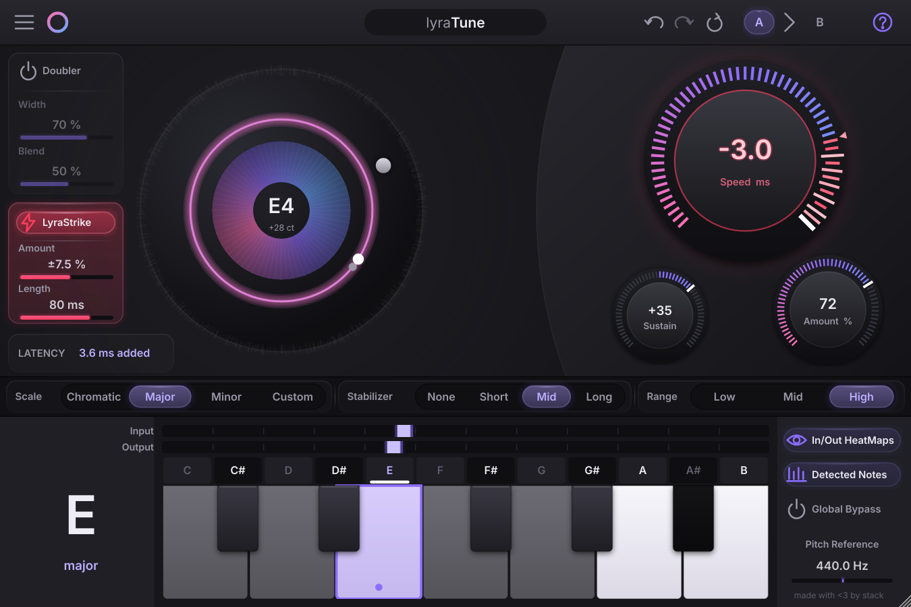

# LyraTune — Free Real-Time Vocal Pitch Correction VST3 with Negative Retune Speed

**An open-source, low-latency vocal tuner plugin for hard-tuned autotune-style effects and natural pitch correction. Retune speed goes below 0 ms.**



LyraTune is a free real-time pitch-correction plugin (VST3, Windows x64, also runs in Windows DAWs under Wine on Linux). It tunes vocals live with 3.6 ms of added latency, from transparent correction to the hard, robotic "snapped" vocal sound — and past it, with **negative retune speed**.

## ⚡ Negative Retune Speed — harder than instant

Most pitch correctors stop at 0 ms: the note jumps straight to the target. LyraTune's **Speed** knob keeps going to **−3 ms**.

**What it does:** below 0 ms the note-change hysteresis shrinks, reaching zero at −3 ms. The output snaps to the next note the moment your voice crosses the midpoint between two notes, for the hardest, most robotic hard-tune sound.

**No lookahead, no extra latency.** The effect is computed causally from the detected pitch, so negative Speed adds 0 ms to the plugin's latency.

**Tip:** pair it with the **Note Stabilizer** if fast runs flip between notes too eagerly.

The Speed knob has a definitive 0 ms notch and visibly "overloads" past it: the negative zone runs red-hot and the orb shifts toward pink.

## Features

### 🎯 Low-Latency Pitch Correction
- **Honest latency reporting:** 3.6 / 5.3 / 7.4 ms of added latency at 48 kHz for the High / Mid / Low pitch ranges.
- **Host delay compensation (PDC):** latency is reported to the host.
- **Retune Speed −3 … 400 ms:** from natural, vibrato-preserving correction to instant hard tuning and the negative zero-hysteresis range.
- **Amount:** blend between the natural and fully corrected pitch.
- **Note Stabilizer:** Short / Mid / Long confirmation so fast runs and grace notes stay natural — zero added latency.
- **Sustain:** retune speed follows note age to tighten or loosen held notes.
- **HQ mode** (main menu): optional 2 ms detector lookahead for tighter tuning (+2 ms, reported to the host).
- **Doubler:** two subtly detuned, drifting voices with Width and Blend for an instant double-track.
- **LyraStrike:** make every note hit harder: a formant accent on each note change (darker going up, brighter going down): ±7.5 % over 80 ms by default, adjustable from ±1 % to ±25 % and from 25 to 100 ms — the tuned pitch is untouched and no latency is added.

### 🎵 Accurate Pitch Detection
- **YIN-based pitch detection** for real-time vocal pitch tracking.
- **Octave- and harmonic-error protection.**
- Built for live vocal monitoring and tracking.

### 🎹 Key and Scale Control
- Chromatic, major, minor and custom scales.
- Click keys to allow or forbid notes; right-click a key to set the root.
- Adjustable pitch reference (A4 = 420–460 Hz).

### 📊 Real-Time Visual Feedback
- **Animated pitch orb** with the detected note and cents.
- **Input and output HeatMaps** driven by real DSP data.

### 🛠️ Workflow
- Undo / redo, A/B snapshots, reset to defaults.
- Resizable interface, 75 % to 150 %.
- Tooltips on every control.

### 🔒 Real-Time Audio Safety
- No memory allocations or locks on the audio thread, verified by automated tests.

## Download & Install

Get `LyraTune-0.4.0-win-x64-vst3.zip` from the [Releases](https://github.com/333stack/LyraTune/releases/latest) page.

- **Windows:** unzip and copy the `Lyra Tune.vst3` folder to `C:\Program Files\Common Files\VST3\`, then rescan plugins in your DAW (FL Studio, Ableton Live, Reaper, Studio One, Cubase, Bitwig…).
- **Linux (Windows DAW under Wine):** copy it to the same folder inside the DAW's Wine prefix:
  `<prefix>/drive_c/Program Files/Common Files/VST3/`.

Format: VST3, Windows x64. Verify downloads with `SHA256SUMS.txt`.

## FAQ

**Is LyraTune free?** Yes. It is free and open source under the AGPL-3.0 license.

**What is negative retune speed?** A Speed setting below 0 ms. Correction stays instant and the note-change hysteresis shrinks to zero at −3 ms, so notes snap exactly at the midpoint between them. See [above](#-negative-retune-speed--harder-than-instant).

**Does negative Speed add latency?** No. It uses no lookahead; latency stays the same as at 0 ms.

**How do I get the hard-tuned "robotic" vocal effect?** Set Speed to 0 ms (or below for extra bite), Amount to 100 %, and choose your song's key and scale.

**How do I get natural pitch correction?** Use Speed 20–80 ms, Amount 60–90 %, and the Note Stabilizer on Mid.

**Can I use it for live vocals?** Yes. It is designed for real-time monitoring: 3.6 ms added latency at 48 kHz in the High range, plus your audio interface's buffer.

**Does it run on Linux?** Through a Windows DAW running under Wine. A native Linux build is not available yet.

## Technical Overview

| Component | Implementation |
|---|---|
| Pitch detection | YIN-based, with octave- and harmonic-error protection |
| Correction | Lag-compensating pitch prediction, critically damped retune, vibrato-aware hysteresis and vibrato keep; negative Speed removes note-change hysteresis |
| Latency at 48 kHz | 3.6 / 5.3 / 7.4 ms (+2 ms in HQ) |
| Latency compensation | Host-reported plugin latency |
| Scale modes | Chromatic, major, minor, custom |
| Audio-thread allocations / locks | None (tested) |
| Format | VST3, Windows x64 |

## Build from Source

Cross-compiled on Linux with clang-cl + lld and `xwin`:

```sh
git clone --recursive https://github.com/333stack/LyraTune.git && cd LyraTune
xwin --accept-license --arch x86_64 --cache-dir ~/.cache/xwin splat --output ~/.local/share/xwin
scripts/setup-xwin-aliases.sh
scripts/build.sh      # -> build/win-release/LyraTune_artefacts/Release/VST3/Lyra Tune.vst3
scripts/test.sh       # native unit tests
```

## Documentation

Full user guide, DSP design, latency tables, measurements, known limitations and roadmap:
**[LyraTune.md](LyraTune.md)**.

## Credits

- **Lead design and engineering:** stack
- **Development assistance:** Claude (AI assistant)

## License

GNU Affero General Public License v3 — see [LICENSE](LICENSE).
Third-party components and notices: [THIRD_PARTY_NOTICES.md](THIRD_PARTY_NOTICES.md).
